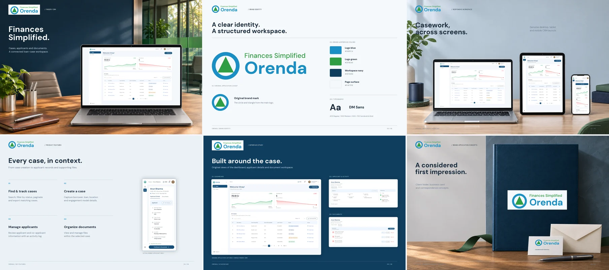

# Orenda Finserv CRM

## Overview

Orenda Finserv CRM is a frontend loan-case management demo for Direct Selling Agents (DSAs). It brings together a dashboard, searchable case records, applicant and co-applicant details, supporting documents, and activity history. React Context and local JSON fixtures simulate the workflows in the browser.

## Project Preview



Application and brand preview.

## Key Features

- **Case browsing:** search by case name, borrower, or creator; filter by status and navigate paginated records.
- **Case creation:** capture borrower, loan, location, and model details with amount validation and PIN-code autofill.
- **Applicant management:** review and edit applicant details, add or edit a co-applicant, and inspect case activity.
- **Document handling:** add, replace, preview, and remove files within the current browser session. Uploaded images and PDFs have inline previews; seeded documents use sample previews.
- **CSV export:** download all matching dashboard cases, including records beyond the visible page, with quoted cells and spreadsheet-formula protection.
- **Responsive interface:** compact navigation on smaller screens, keyboard-operated dropdowns, focus-managed dialogs, notifications, and status feedback.

Cases, edits, notifications, and uploaded files live in memory and reset on refresh. Dashboard metrics and historical records are sample data. There is no database, authentication service, server-side file storage, or interactive loan approval/disbursal workflow. Support and Logout display notices explaining their demo behavior. Unknown PIN codes need network access; lookup failures provide retry feedback.

## Live Website & Related Repository

https://orenda-finserv.vercel.app/

## Tech Stack

| Area                | Technology                                    |
| ------------------- | --------------------------------------------- |
| Interface           | React 19, JavaScript, JSX                     |
| Tooling             | Vite 8                                        |
| Styling             | Tailwind CSS 4, DM Sans                       |
| Routing             | React Router DOM 7                            |
| State and data      | React Context, component state, JSON fixtures |
| Icons and utilities | Lucide React, clsx, tailwind-merge            |
| Checks              | Oxlint, Node.js test runner                   |

## Prerequisites

Node.js matching `^20.19.0 || >=22.12.0` and npm. Google Fonts and the fallback postal lookup need network access.

## Installation & Setup

1. Open the repository root.
2. Install the locked dependencies.

   ```sh
   npm ci
   ```

3. The application uses bundled JSON fixtures and component state. No environment variables or service credentials are required.

## Running Locally

Start development with `npm run dev` and open the URL printed by Vite, normally `http://localhost:5173/`.

| Command           | Purpose                                    |
| ----------------- | ------------------------------------------ |
| `npm run dev`     | Start the development server               |
| `npm run build`   | Create a production build in `dist/`       |
| `npm run preview` | Serve an existing production build locally |
| `npm run lint`    | Run Oxlint                                 |
| `npm test`        | Run focused regression tests         |

For a production preview, run `npm run build` before `npm run preview`. The included `vercel.json` supplies the single-page application fallback for direct links to case routes.

## Project Structure

```text
public/                 # Public assets and README preview
src/
├── components/         # Forms, dialogs, and shared controls
├── contexts/           # Shared application state
├── data/               # JSON fixtures
├── hooks/              # Applicant form behavior
├── pages/              # Dashboard, cases, and case details
├── utils/              # CSV, location, and value helpers
├── App.jsx             # Routing and application composition
└── index.js            # React entry
tests/                  # Regression tests
vercel.json             # SPA route fallback
```
